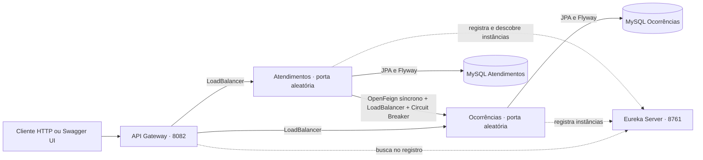

# CidadeAtiva

**Plataforma Inteligente de Ocorrências Urbanas**

Global Solution 2026-02 da FIAP · Microservice and Web Engineering & IT Services · DP 1º SID

## Problema e público

Um semáforo apagado, uma calçada danificada ou uma luminária queimada afetam quem circula pelo bairro. Quando o registro e o acompanhamento ficam espalhados por canais diferentes, o cidadão perde a referência do pedido e a equipe de zeladoria tem dificuldade para identificar a situação e o responsável.

O CidadeAtiva oferece um protocolo de ocorrência e um atendimento associado. Moradores e pessoas que circulam na região podem consultar o andamento pelo ID. Equipes de zeladoria registram o responsável, definem a prioridade e atualizam a execução. O protótipo usa dados fictícios e exige apenas informações sobre o local e o problema para abrir uma ocorrência.

Um piloto pode comparar o tempo entre registro e abertura do atendimento e a proporção de ocorrências resolvidas por categoria e bairro. O fluxo da API demonstra o acompanhamento de ponta a ponta.

## Objetivos de Desenvolvimento Sustentável

- **ODS 9 · Indústria, inovação e infraestrutura.** O registro por categoria e local ajuda equipes a identificar falhas recorrentes e planejar a manutenção de infraestrutura urbana. [Meta 9.1](https://sdgs.un.org/goals/goal9)
- **ODS 11 · Cidades e comunidades sustentáveis.** O cidadão pode registrar problemas que afetam a mobilidade e a segurança, como calçadas danificadas e semáforos apagados, e acompanhar a resposta. [Metas 11.2 e 11.3](https://sdgs.un.org/goals/goal11)
- **ODS 16 · Paz, justiça e instituições eficazes.** O protocolo, a atribuição de responsável e a consulta de status dão transparência ao tratamento das solicitações. [Metas 16.6 e 16.10](https://sdgs.un.org/goals/goal16)

## Arquitetura



| Módulo | Responsabilidade |
| --- | --- |
| `eureka-server` | Registro e descoberta das instâncias. |
| `api-gateway` | Rotas públicas, Swagger e balanceamento via `lb://`. |
| `ocorrencias-service` | CRUD, status da ocorrência e contrato interno de sincronização. |
| `atendimentos-service` | CRUD, prioridade, atribuição e ciclo de vida do atendimento. |
| `scripts/validar.py` | Verificação HTTP com as APIs e os componentes em execução. |

Cada microsserviço tem pacotes `entity`, `dto/request`, `dto/response`, `repository`, `service`, `controller` e `exception`. Cada banco tem suas próprias migrations `V1` para estrutura e `V2` para dados de demonstração. O Hibernate valida as tabelas no startup.

### Versões

| Componente | Versão |
| --- | --- |
| Java / Temurin | 25 |
| Spring Boot | 4.0.9 em todos os módulos |
| Spring Cloud | 2025.1.4, incluindo Eureka, Gateway, OpenFeign, LoadBalancer e Circuit Breaker com Resilience4j |
| Springdoc OpenAPI | 3.0.3 |
| MySQL | 8.4 LTS |
| Spring Data JPA, Hibernate, Flyway, JDBC e bibliotecas de testes | Gerenciados pelo Spring Boot e pelo BOM do Spring Cloud |
| Maven na imagem de build | 3.9.11 |

O Spring Cloud 2025.1.4 é baseado no Boot 4.0.9. O Springdoc 3.0.x é a linha construída para o Boot 4.0.x. [Spring Cloud](https://spring.io/blog/2026/10/23/spring-cloud-2025-1-4-has-been-released/) · [Springdoc](https://springdoc.org/#what-is-the-compatibility-matrix-of-springdoc-openapi-with-spring-boot)

## Executar em ambiente limpo

O ambiente de execução requer Docker Engine ou Docker Desktop com containers Linux, Compose, daemon em execução, acesso às imagens e dependências no primeiro build e portas locais `8761` e `8082` livres. Java, Maven e MySQL são fornecidos pelas imagens.

Execute os comandos a seguir na raiz do repositório.

```sh
docker compose up --build -d
docker compose ps
docker compose logs --tail=100 eureka-server api-gateway ocorrencias-service atendimentos-service
```

Os quatro Dockerfiles multi-stage compartilham a etapa Maven que compila e testa o monorepo. Cada imagem de execução recebe o JRE e o JAR do seu módulo. O Compose limita cada container a 512 MiB e o heap de cada JVM a 192 MiB. Cada MySQL usa um buffer pool de 64 MiB e aceita até 60 conexões.

O Compose inicializa os dois bancos e aguarda os healthchecks do MySQL e do Eureka antes de iniciar seus dependentes. Aguarde os seis containers aparecerem como `healthy` e os dois serviços ficarem `UP` no Eureka. O Gateway pode levar alguns segundos para buscar o registro.

Para construir as imagens em uma etapa separada, execute `docker compose build`. Para aguardar os healthchecks na inicialização, execute `docker compose up --build --wait`.

Se o BuildKit falhar, o builder clássico também pode construir as quatro imagens em série. No Windows, execute os comandos abaixo na raiz do projeto. As variáveis de ambiente valem apenas para o processo iniciado por `cmd.exe`.

```powershell
cmd.exe /d /c "set DOCKER_BUILDKIT=0&& set COMPOSE_BAKE=false&& docker compose --parallel 1 build"
docker compose up -d --no-build --wait
```

| Acesso | Endereço |
| --- | --- |
| Eureka | [http://localhost:8761](http://localhost:8761) |
| Saúde do Gateway | [http://localhost:8082/actuator/health](http://localhost:8082/actuator/health) |
| API de Ocorrências | [http://localhost:8082/api/v1/ocorrencias](http://localhost:8082/api/v1/ocorrencias) |
| API de Atendimentos | [http://localhost:8082/api/v1/atendimentos](http://localhost:8082/api/v1/atendimentos) |
| Swagger de Ocorrências | [Abrir Swagger UI](http://localhost:8082/docs/ocorrencias/swagger.html) · [JSON OpenAPI](http://localhost:8082/docs/ocorrencias/openapi) |
| Swagger de Atendimentos | [Abrir Swagger UI](http://localhost:8082/docs/atendimentos/swagger.html) · [JSON OpenAPI](http://localhost:8082/docs/atendimentos/openapi) |

Os Swagger UIs executam as requisições pelo Gateway. Use **Try it out** para testar os DTOs de exemplo. O ambiente começa com duas ocorrências e um atendimento associado à ocorrência 2.

## API e regras de negócio

| Método | Rota | Resultado |
| --- | --- | --- |
| `GET` | `/api/v1/ocorrencias` | `200`, lista de ocorrências. |
| `GET` | `/api/v1/ocorrencias/{id}` | `200`, detalhe da ocorrência. |
| `POST` | `/api/v1/ocorrencias` | `201`, ocorrência aberta com `Location`. |
| `PUT` | `/api/v1/ocorrencias/{id}` | `200`, dados cadastrais atualizados. |
| `DELETE` | `/api/v1/ocorrencias/{id}` | `204` se a ocorrência estiver sem atendimento vinculado. |
| `GET` | `/api/v1/atendimentos` | `200`, lista de atendimentos. |
| `GET` | `/api/v1/atendimentos/{id}` | `200`, detalhe do atendimento. |
| `POST` | `/api/v1/atendimentos` | `201`, atendimento aberto com `Location` e ocorrência encaminhada. |
| `PUT` | `/api/v1/atendimentos/{id}` | `200`, dados e prioridade atualizados. |
| `PUT` | `/api/v1/atendimentos/{id}/status` | `200`, atendimento iniciado ou concluído com ocorrência sincronizada. |
| `DELETE` | `/api/v1/atendimentos/{id}` | `204`, atendimento excluído e ocorrência desvinculada. |

| Ação | Atendimento | Ocorrência |
| --- | --- | --- |
| Registrar ocorrência | — | `ABERTA` |
| Criar atendimento | `ABERTO` | `ENCAMINHADA` |
| Iniciar atendimento | `EM_ANDAMENTO` | `EM_ATENDIMENTO` |
| Concluir atendimento | `CONCLUIDO` | `RESOLVIDA` |
| Excluir atendimento | Excluído | `ABERTA` se estava pendente, `RESOLVIDA` se estava concluído |

Cada ocorrência admite um atendimento vinculado. Uma ocorrência resolvida encerra seu fluxo. A associação `ocorrenciaId` é definida na criação e o progresso é alterado pela rota de status. Exclua o atendimento antes de excluir a ocorrência. A regra de unicidade no MySQL e os bloqueios de linha protegem alterações concorrentes entre instâncias.

Dados inválidos ou IDs inválidos retornam `400`. Recursos inexistentes retornam `404`. Duplicidade, vínculo impeditivo e transições inválidas retornam `409`. Os erros da API são retornados como `application/problem+json`, com detalhes e campos inválidos quando aplicável.

### Fluxo de exemplo com curl

Os comandos abaixo usam Bash. No Windows, as mesmas operações podem ser executadas nos Swagger UIs. Use os IDs retornados por cada `POST` nas variáveis `OC` e `AT`.

```bash
BASE=http://localhost:8082/api/v1

# Criar ocorrência e conferir HTTP 201 e Location
curl -i -X POST "$BASE/ocorrencias" -H 'Content-Type: application/json' \
  -d '{"titulo":"Semáforo apagado","descricao":"Sinais apagados no cruzamento.","categoria":"Mobilidade","endereco":"Av. do Estado, 120, São Paulo - SP"}'
OC=3

# Listar, consultar e editar
curl -fsS "$BASE/ocorrencias"
curl -fsS "$BASE/ocorrencias/$OC"
curl -fsS -X PUT "$BASE/ocorrencias/$OC" -H 'Content-Type: application/json' \
  -d '{"titulo":"Semáforo apagado","descricao":"Falha confirmada em vistoria.","categoria":"Mobilidade","endereco":"Av. do Estado, 120, São Paulo - SP"}'

# Associar um atendimento e consultar o status ENCAMINHADA
curl -i -X POST "$BASE/atendimentos" -H 'Content-Type: application/json' \
  -d "{\"ocorrenciaId\":$OC,\"responsavel\":\"Equipe de Sinalização\",\"descricao\":\"Verificar alimentação elétrica\",\"prioridade\":\"ALTA\"}"
AT=2
curl -fsS "$BASE/ocorrencias/$OC"

# Listar, consultar e editar o atendimento
curl -fsS "$BASE/atendimentos"
curl -fsS "$BASE/atendimentos/$AT"
curl -fsS -X PUT "$BASE/atendimentos/$AT" -H 'Content-Type: application/json' \
  -d '{"responsavel":"Equipe de Sinalização","descricao":"Substituir equipamento","prioridade":"URGENTE"}'

# Iniciar e confirmar EM_ATENDIMENTO na ocorrência
curl -fsS -X PUT "$BASE/atendimentos/$AT/status" -H 'Content-Type: application/json' -d '{"status":"EM_ANDAMENTO"}'
curl -fsS "$BASE/ocorrencias/$OC"

# Concluir e confirmar RESOLVIDA na ocorrência
curl -fsS -X PUT "$BASE/atendimentos/$AT/status" -H 'Content-Type: application/json' -d '{"status":"CONCLUIDO"}'
curl -fsS "$BASE/ocorrencias/$OC"

# Excluir na ordem do vínculo e confirmar HTTP 204
curl -i -X DELETE "$BASE/atendimentos/$AT"
curl -i -X DELETE "$BASE/ocorrencias/$OC"
```

### Circuit Breaker e fallback

O cliente OpenFeign resolve `ocorrencias-service` pelo Eureka e chama `PUT /api/v1/interno/ocorrencias/{id}/atendimento` via LoadBalancer. Esse caminho é acessível dentro da rede dos serviços. O corpo informa o identificador do atendimento e a ação, como em `{"atendimentoId":7,"acao":"INICIAR"}`. O serviço de Ocorrências responde `204` após a atualização. O serviço de Atendimentos confirma a operação ao cliente após essa resposta e a confirmação da transação local.

O Resilience4j avalia uma janela de quatro chamadas e abre o circuito quando pelo menos 50% falham. Após cinco segundos, o circuito permite duas chamadas de teste. Erros de recurso inexistente e conflito de domínio são propagados com `404` e `409`. Indisponibilidade, timeout ou circuito aberto acionam o fallback com `503` e rollback da operação de Atendimento.

Os bancos confirmam transações separadas. Se a resposta HTTP se perder após a confirmação no banco de Ocorrências, pode haver divergência temporária. A sincronização é idempotente para a mesma etapa, permitindo repetir a operação após a recuperação. O ID do atendimento identifica o vínculo e impede que chamadas atrasadas modifiquem um vínculo mais recente. Se um `POST` tiver sido confirmado e a resposta ao cliente se perder, consulte a lista pelo `ocorrenciaId` para localizar o atendimento.

O teste de indisponibilidade usa dois registros de demonstração.

1. Crie uma ocorrência sem vínculo e anote seu ID. Crie outra ocorrência e abra um atendimento nela. Anote o ID do atendimento em `ABERTO`.
2. Pare as instâncias de Ocorrências com `docker compose stop ocorrencias-service`.
3. Tente criar um atendimento para a primeira ocorrência ou iniciar o atendimento já aberto. Ambas as operações devolvem `503`. Consulte o atendimento existente e confirme que segue `ABERTO`. A lista também permite confirmar que a primeira ocorrência segue sem atendimento.
4. Execute `docker compose start ocorrencias-service`. Aguarde o registro no Eureka e repita o início. Consulte a segunda ocorrência e confirme `EM_ATENDIMENTO`.

### Validação automatizada e múltiplas instâncias

`mvn clean verify` compila os quatro módulos e roda os testes unitários com Java 25. O comando `docker compose build` também roda os testes de cada módulo nas imagens.

Com a aplicação em execução, o script abaixo usa Python 3.8 ou superior e verifica Eureka, Swagger, dados iniciais, CRUDs, regras e sincronização. Os registros que ele cria são removidos ao final de um fluxo bem-sucedido.

```sh
python scripts/validar.py
docker compose up -d --scale ocorrencias-service=2 --scale atendimentos-service=2
python scripts/validar.py --instancias 2
```

O script também pode verificar rollback por indisponibilidade. Após preparar os dois IDs do teste de fallback e parar Ocorrências, execute `python scripts/validar.py --fallback OCORRENCIA_ID ATENDIMENTO_ID` usando os números reais. Substitua `python` por `python3` se o executável tiver esse nome no seu ambiente.

Sem Python, confirme no Eureka que cada microsserviço tem duas instâncias `UP` e repita o fluxo HTTP. As réplicas não precisam de portas publicadas. Cada uma registra IP e porta aleatória no Eureka, e o Gateway e o Feign resolvem as instâncias no momento da chamada.

Os logs de inicialização registram as migrations aplicadas. Os comandos abaixo consultam o histórico do Flyway diretamente em cada banco.

```sh
docker compose exec mysql-ocorrencias mysql -u cidadeativa -pocorrencias_dev cidadeativa_ocorrencias -e 'SELECT version, description, success FROM flyway_schema_history;'
docker compose exec mysql-atendimentos mysql -u cidadeativa -patendimentos_dev cidadeativa_atendimentos -e 'SELECT version, description, success FROM flyway_schema_history;'
```

## Encerrar

Execute `docker compose down` para remover os containers e a rede, preservando os dados nos volumes. Para reiniciar a demonstração do zero, `docker compose down -v` também apaga os volumes e os dados locais deste projeto.

## Validação realizada

O Maven compilou e empacotou os quatro módulos com Java 25 e executou dez testes unitários com sucesso. Em execução nativa com dois servidores MySQL 8.4.13, as migrations criaram e popularam ambos os bancos. O teste HTTP verificou os dois CRUDs, os contratos OpenAPI, os Swagger UIs e o balanceamento do Gateway entre duas instâncias por microsserviço. A parada do serviço de Ocorrências produziu HTTP 503 com rollback em Atendimentos. Após a retomada, a mesma alteração foi concluída e o status da ocorrência foi sincronizado.

No Docker Desktop com containers Linux, o Compose construiu as quatro imagens com BuildKit e também com o builder clássico (`DOCKER_BUILDKIT=0`). Os dez testes unitários passaram nos dois builds. Com as imagens do BuildKit, `scripts/validar.py` passou com uma e com duas instâncias de cada microsserviço. Com as imagens do builder clássico, os seis containers passaram nos healthchecks e o script repetiu o fluxo completo com uma instância de cada serviço.

As consultas ao histórico do Flyway confirmaram V1 e V2 nos dois MySQL. Com Ocorrências parado, criar, iniciar e excluir atendimentos devolveu HTTP 503 e a transação local sofreu rollback. Após o reinício, a mesma solicitação de início atualizou a ocorrência para `EM_ATENDIMENTO`.

## Entrega acadêmica

O enunciado exige que o TXT enviado pelo Portal do Aluno contenha o nome do aluno, o RM e o link do monorepo público no GitHub.
